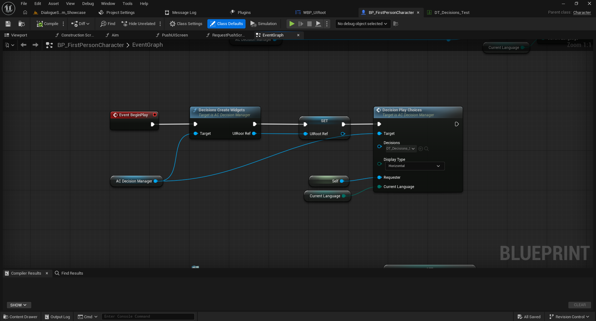

# Dialogue System Framework — English Documentation

**Complete dialogue and decision framework for Unreal Engine 5.** Built entirely with Blueprints, driven by Data Tables, and designed to integrate through the `AC_DialogueManager` and `AC_DecisionManager` Actor Components.

> Create conversations, interactive choices, Rich Text highlights, voiced dialogue, and gameplay events without writing C++.

**[Full Framework on Fab](https://www.fab.com/listings/e6c1f535-2990-4551-8303-c3405ebd7aad)** · **[Watch the showcase](https://youtu.be/sOUxLFjuRq0)** · **[Download the Full playable demo](https://mega.nz/file/BqxC2CZa#zAplOAOMxhFl9x-6w8IYzfUxBjKvCPLndjz7heS21YU)**

## Documentation index

1. [Installation and quick start](docs/01-installation.md)
2. [Conversations and Data Tables](docs/02-conversations.md)
3. [Gameplay events with Blueprint Interfaces](docs/03-events.md)
4. [Decision system with Common UI](docs/04-decisions.md)
5. [Rich Text and colored words](docs/05-rich-text.md)
6. [Audio, timing, and controls](docs/06-audio-and-controls.md)
7. [Localization and dialogue layouts](docs/07-localization-and-layouts.md)
8. [Upgrading from Free and legacy versions](docs/08-upgrading.md)
9. [Troubleshooting and FAQ](docs/09-troubleshooting.md)
10. [Architecture and extensibility](docs/10-architecture.md)

## Main features

- Data Table conversations using `ST_DialogueLine`.
- `AC_DialogueManager` attaches to your player; **no custom GameInstance required**.
- Interactive choices powered by **Common UI** and configured through Data Tables.
- Rich Text styles for highlighting individual words.
- Subtitle and centered dialogue presentations.
- English and Spanish localized text, prompts, and voice audio.
- Audio synchronization, line duration, and delays between lines.
- Per-line skip control (`AllowSkip`) and contextual prompts.
- Gameplay events through `BPI_DialogueEvents`, plus conversation start/finish notifications.

## Requirements

- Unreal Engine 5 and a Blueprint-enabled project.
- **Common UI plugin** (bundled with Unreal Engine): enable it under **Edit > Plugins** and restart the editor if prompted.
- The Full package installed from Fab.
- Check the product's Fab listing for the specific supported UE5 versions and platforms.

## Full framework components



## Your first conversation

1. Add `AC_DialogueManager` to your Player Character Blueprint.
2. On `BeginPlay` (for testing), call `Dialogue Create Widgets`, with the component as `Target`.
3. Call `Dialogue Play Conversation` and provide your Data Table through the `Conversation` pin. Also connect `Current Language` when available in the Full setup.
4. Run the level. Later you can start the conversation from an NPC interaction rather than `BeginPlay`.

```text
Event BeginPlay
    → Dialogue Create Widgets (Target: AC_DialogueManager)
    → Dialogue Play Conversation (Target: AC_DialogueManager,
                                  Conversation: DT_MyConversation,
                                  Current Language: Current Language)
```

See the [step-by-step installation guide](docs/01-installation.md).

## Compatibility with the Free Starter Pack

Your **conversation Data Tables** from the Free Starter Pack can be reused in Full. Keep your existing dialogue content and connect it to the Full Actor Component; there is no need to rewrite every line. Decisions and Rich Text are additional Full features that you configure separately.

**[Get the Free Starter Pack](https://www.fab.com/listings/1d39c10d-b6b0-4dd1-b704-8b3d60658e23)** · [Upgrade guide](docs/08-upgrading.md)

## Support and other documentation

- [Spanish Full documentation](https://github.com/wohostudios/ue5-dialogue-system-es)
- [Spanish-speaking Discord community](https://discord.gg/JY5JTQaWqn)
- [Free Starter Pack documentation in English](https://github.com/wohostudios/ue5-dialogue-system-starter-pack-en)

**Documentation note:** The instructions reflect the shared Full Blueprint screenshots and workflows. Any step marked **Verify in your project** should be confirmed against the shipped Full asset before treating it as an exact integration contract.
