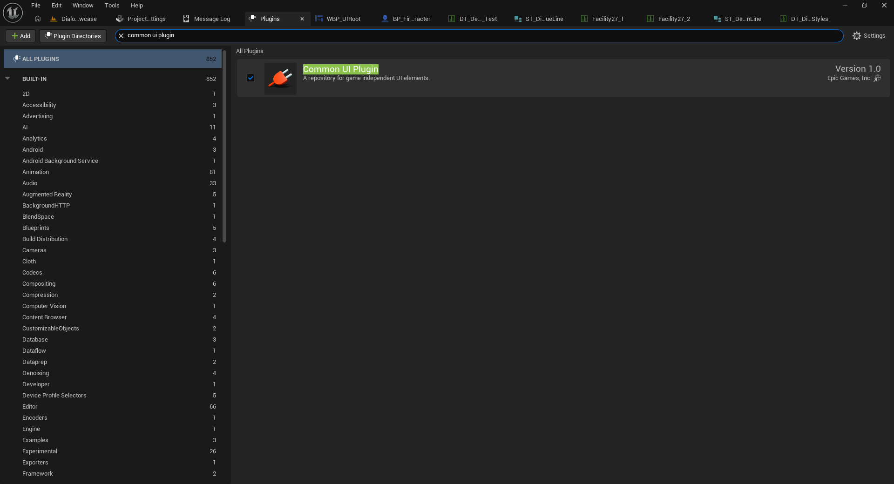
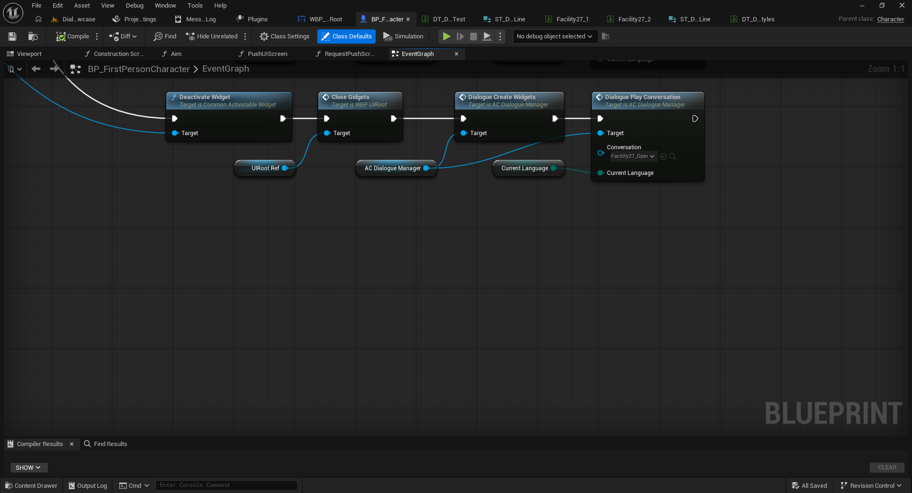
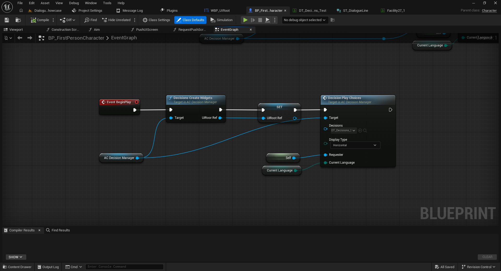

# 01 — Installation and Quick Start

[← Documentation index](../README.md)

## 1. Requirements

- A UE5 version supported by the product's Fab listing.
- **Common UI**, included with UE5 and required for the decision system. Open **Edit > Plugins**, search for **Common UI**, enable it, and restart when prompted.
- The Full package imported into your project. C++ and replacement `GameInstance`, `GameMode`, or `PlayerController` classes are not required.



## 2. Add both Actor Components

1. Open your player Blueprint, such as `BP_FirstPersonCharacter`.
2. Under **Components > Add**, add **`AC_DialogueManager`** for dialogue.
3. Add **`AC_DecisionManager`** for Common UI decisions.
4. Compile and save.

In the demo these assets are located at `Content/DialogueSystem/Blueprints/Core/AC_DialogueManager` and `Content/DialogueSystem/DecisionsSystem/Blueprints/Core/AC_DecisionManager`.


## 3. Start a conversation

1. Drag `AC_DialogueManager` from the Components panel into the player's **Event Graph**.
2. Call **`Dialogue Create Widgets`** with that component as `Target`.
3. Next call **`Dialogue Play Conversation`**, again using the same component as `Target`.
4. Select a conversation Data Table based on `ST_DialogueLine` on the `Conversation` pin and provide `Current Language`.

```text
Event BeginPlay (testing example)
    → Dialogue Create Widgets (Target: AC_DialogueManager)
    → Dialogue Play Conversation (Target: AC_DialogueManager,
                                  Conversation: DT_MyConversation,
                                  Current Language: Current Language)
```



**Note:** The screenshot includes a demo flow that first closes decision widgets before reopening dialogue. `Deactivate Widget` and `Close Gidgets` are not required for a standalone first conversation. In a real game, begin the dialogue from an interaction instead of always using `BeginPlay`.

## 4. Start the decision system

For a basic test, call `Decisions Create Widgets` on `AC_DecisionManager`, save its `UIRoot Ref`, and run `Decision Play Choices` with your decision Data Table, `Requester`, and `Current Language`. See [04 — Decisions](04-decisions.md).



Next: [Conversations](02-conversations.md).
