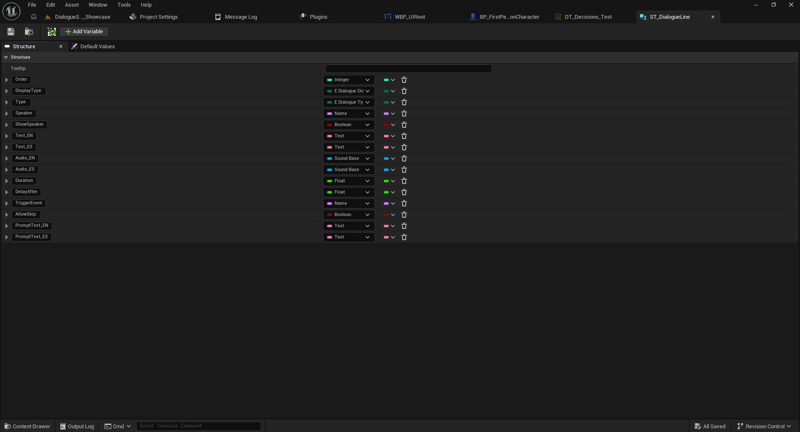
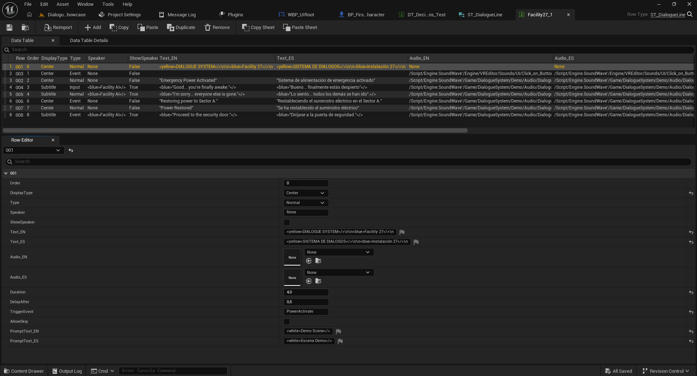

# 02 — Conversations and Data Tables

[← Documentation index](../README.md)

## 1. Create a Data Table

1. Open the **Content Browser**.
2. Right-click and choose **Miscellaneous > Data Table**.
3. Select `ST_DialogueLine` as the row structure.
4. Name the table, for example `DT_MyConversation`.
5. Open it and add one row per dialogue line or instruction.

## 2. Configure each row

`Order` determines dialogue order, while `Row Name` identifies a record. Use clear IDs such as `001`, `002`, `003` and explicit ordering.

| Field | Purpose |
|---|---|
| `Order` | Execution order. |
| `DisplayType` | Presentation style, such as `Subtitle` or `Center`. |
| `Type` | Line category (`Normal`, `Event`, `Input`, etc., depending on your installed enum). |
| `Speaker` | Speaker identifier. |
| `ShowSpeaker` | Show or hide the speaker name. |
| `Text_ES` / `Text_EN` | Localized dialogue text. |
| `Audio_ES` / `Audio_EN` | Localized voice assets, if any. |
| `Duration` | Configured line duration. |
| `DelayAfter` | Pause before the next line. |
| `TriggerEvent` | Event identifier sent via `BPI_DialogueEvents`. |
| `AllowSkip` | Per-line skip control in Full. |
| `PromptText_ES` / `PromptText_EN` | Localized contextual prompts. |

**Note:** Some Full asset variants may show additional color or presentation fields. Use the exact field names in your installed version. `DisplayType` and `Type` are not the same setting.

## 3. Simple example

| Row Name | Order | Speaker | Text_EN |
|---|---:|---|---|
| `001` | 0 | Guide | Welcome to the facility. |
| `002` | 1 | Guide | Find the emergency generator. |
| `003` | 2 | Guide | Be careful. |

Use the normal dialogue value provided by your version's `Type` enum and select `DisplayType = Subtitle` to show subtitles.

## 4. Play the conversation

With `AC_DialogueManager` on your player, call `Dialogue Create Widgets`, then `Dialogue Play Conversation`, and connect the Data Table to `Conversation`.

Next: [Events](03-events.md).
