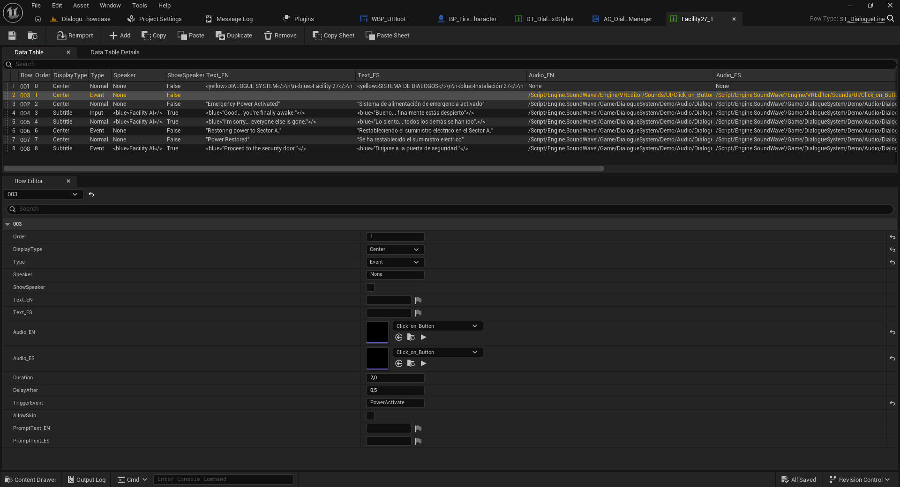
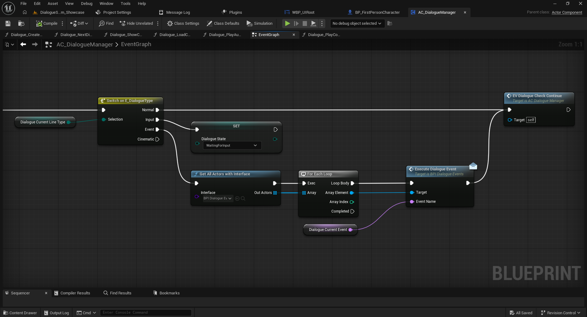
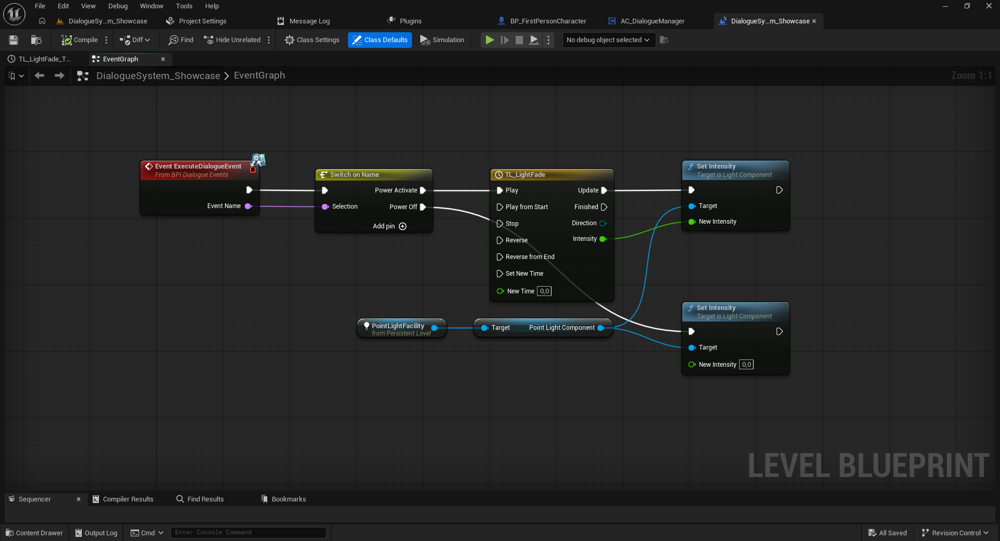
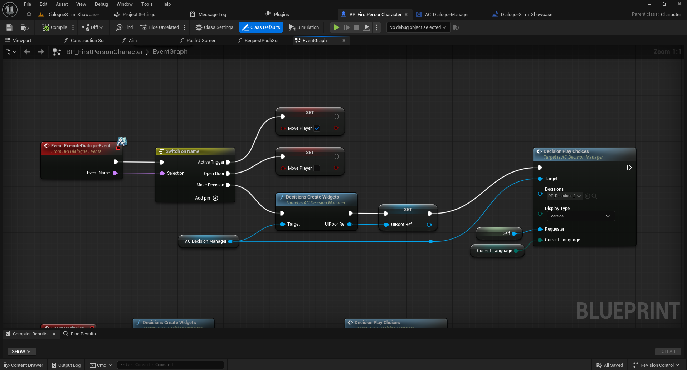

# 03 — Gameplay Events with Blueprint Interfaces

[← Documentation index](../README.md)

Gameplay events let dialogue affect your game without adding project-specific behavior to `AC_DialogueManager`.

## 1. Set up an event in a Data Table

When appropriate, set the dialogue row's `Type` to `Event`, then enter an event identifier in `TriggerEvent`, such as `PowerActivate`. The identifier must match the event name handled by the receiving Blueprint.



## 2. Configure the receiving Blueprint

1. Open the actor that should react, such as a door, a light, or the player Blueprint.
2. Under **Class Settings > Implemented Interfaces**, add `BPI_DialogueEvents` and compile.
3. In its **Event Graph**, implement `Event ExecuteDialogueEvent`.
4. Connect `Event Name` to `Switch on Name` and add a `PowerActivate` case.
5. Connect that case to your gameplay logic (turn on a light, open a door, set a variable, etc.).

## 3. How the message is delivered

The dialogue system uses, **Get All Actors with Interface** finds actors implementing `BPI_DialogueEvents`; **For Each Loop** iterates the results and **Execute Dialogue Event** sends the `Event Name` to each receiver.

```text
Conversation Data Table (TriggerEvent: PowerActivate)
  → Dialogue Actor Component
  → Get All Actors with Interface (BPI_DialogueEvents)
  → For Each Loop
  → Execute Dialogue Event (Event Name)
  → Receiver: Switch on Name
  → PowerActivate → Gameplay action
```

**Important:** Multiple actors may receive the same message. Filter by event name inside each receiver.








## 4. Opening decisions from dialogue events

The Full demo handles `Make Decision` in `Switch on Name` to open choices through `AC_DecisionManager`. See the [decision guide](04-decisions.md).

Next: [Decisions](04-decisions.md).
