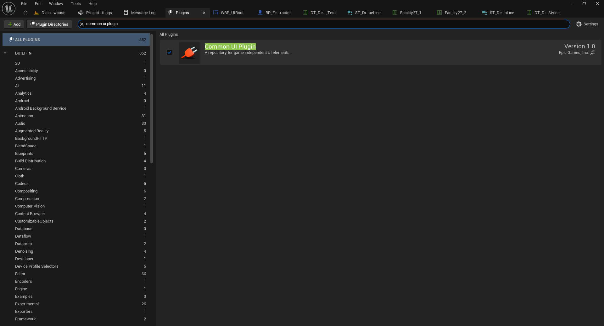
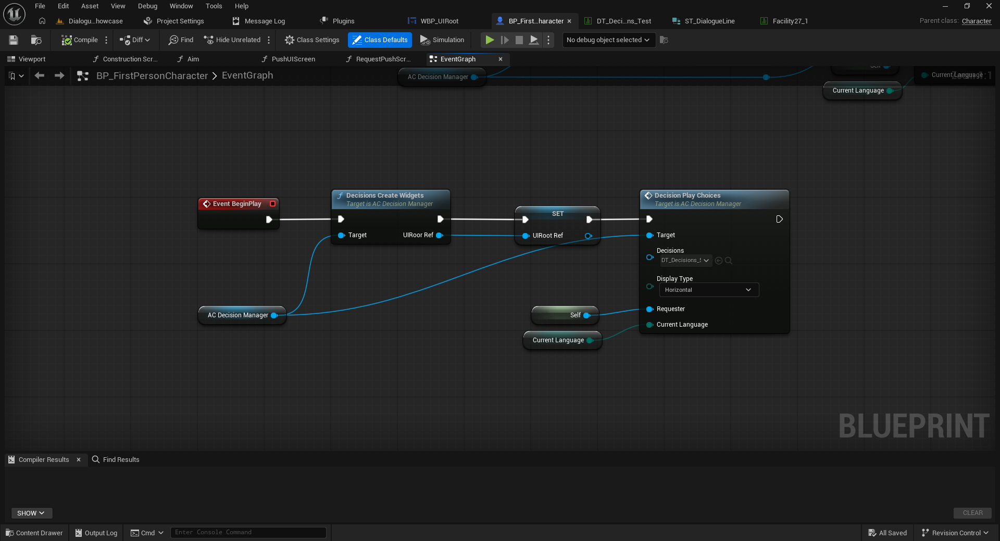
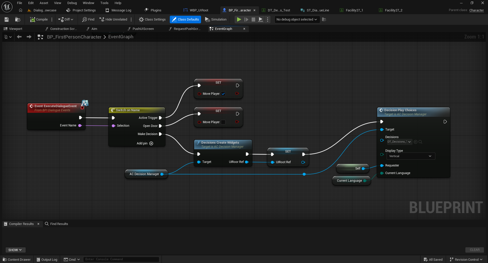
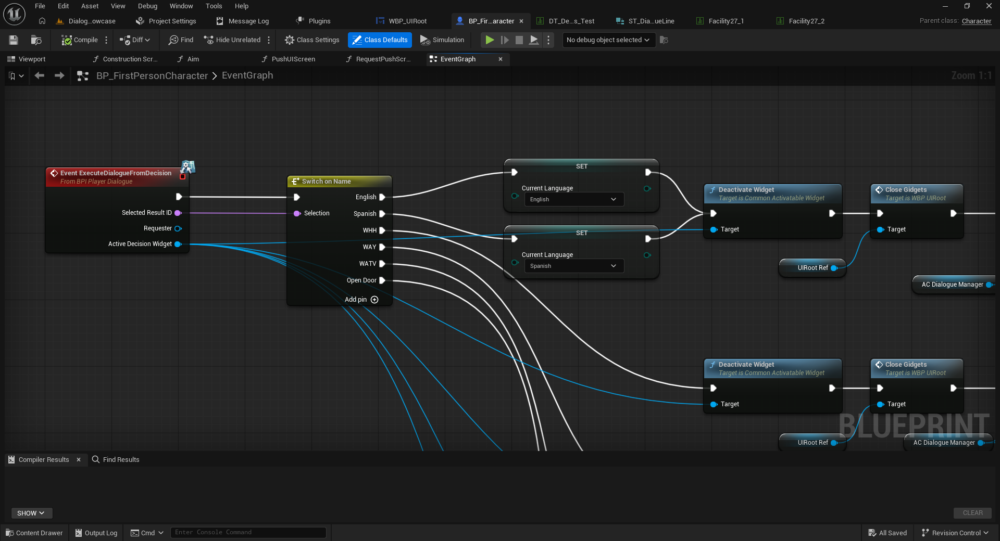
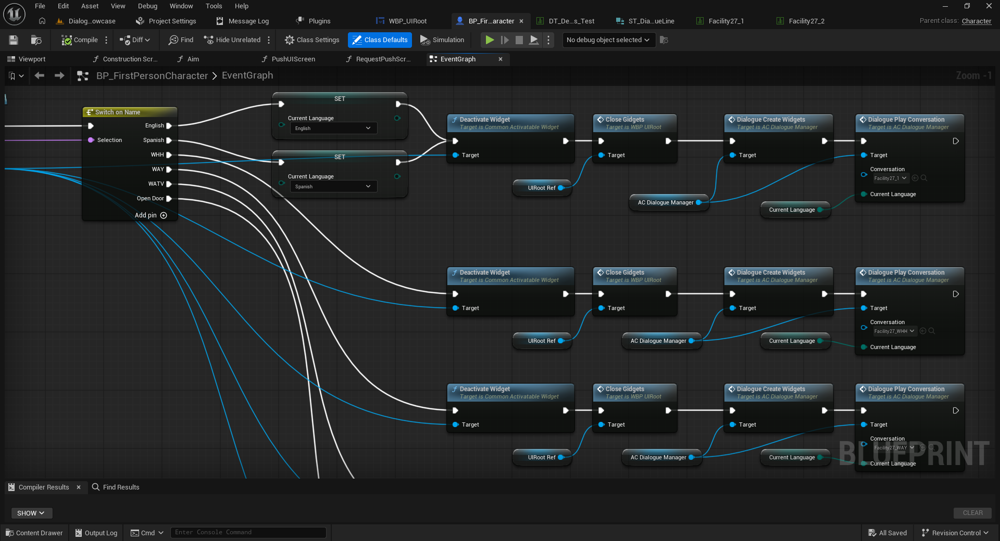
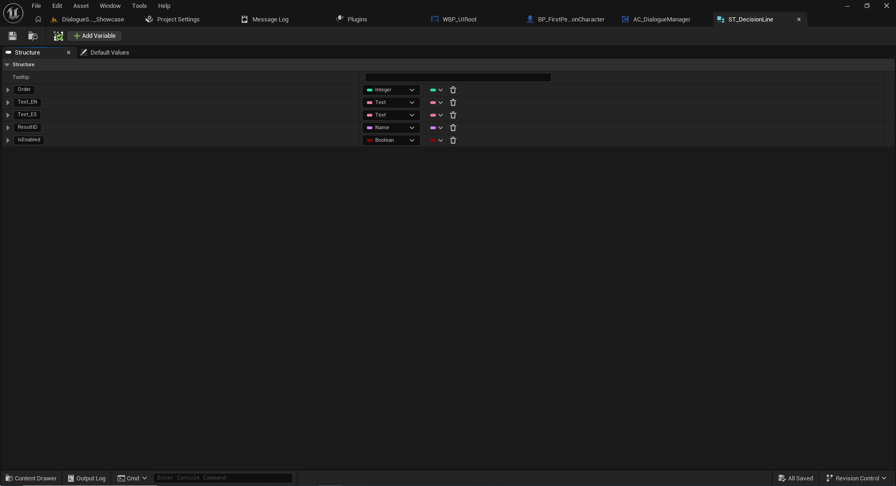
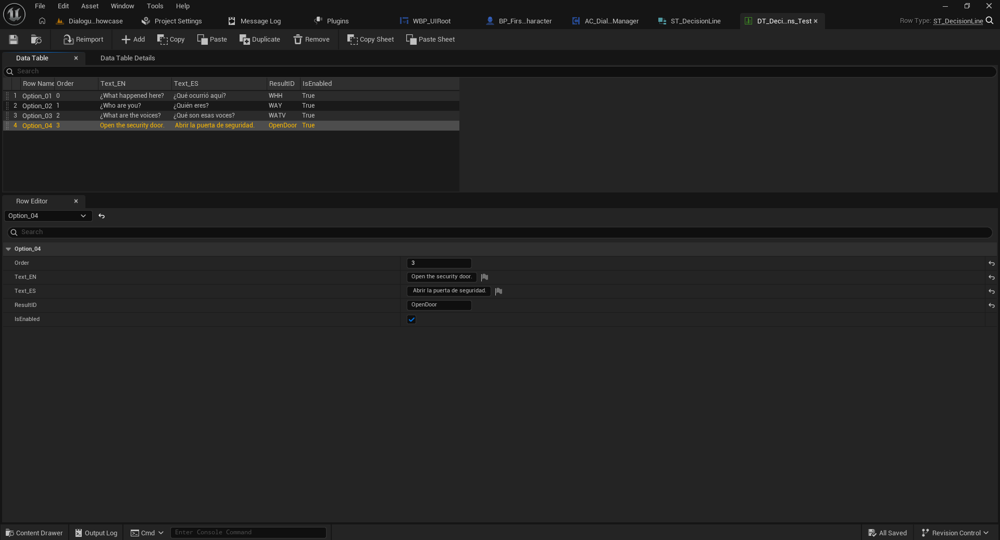
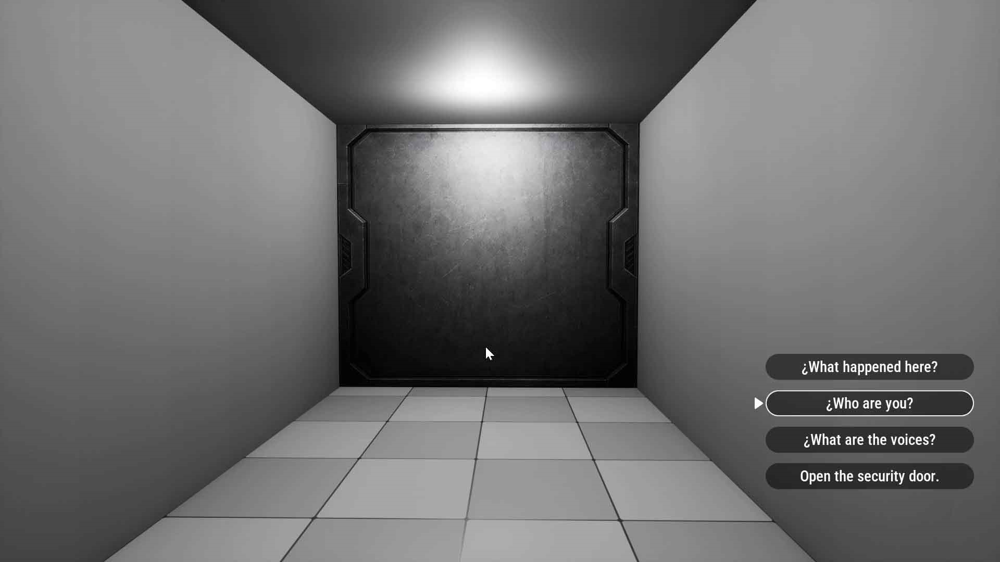

# 04 — Decision System with Common UI (Full)

[← Documentation index](../README.md)

Full provides an independent decision system built with **`AC_DecisionManager`**, **Common UI** buttons, and choice Data Tables. It can launch directly from the player Blueprint or in response to a dialogue event.

## 1. Enable Common UI

In Unreal Engine, open **Edit > Plugins**, search for **Common UI**, enable it, and restart when prompted.



## 2. Prepare the player

1. Open your player Blueprint (`BP_FirstPersonCharacter` in the demo).
2. Add `AC_DecisionManager` under **Components > Add**.
3. Compile and save.
4. Drag a reference to the component into the **Event Graph** to use as `Target`.

## 3. Create widgets and display choices

The example initializes choices from `Event BeginPlay`:

1. Call **`Decisions Create Widgets`** with `AC_DecisionManager` as `Target`.
2. Save the returned `UIRoot Ref` in a variable (also named `UIRoot Ref` in the demo).
3. Call **`Decision Play Choices`** with the same component as `Target`.
4. On `Decisions`, select the choice table (`DT_Decisions_Test` in the demo).
5. Choose `Display Type`: `Horizontal` or `Vertical`.
6. Connect `Requester` to the actor that receives the selected result (demo: `Self`).
7. Connect the current language to `Current Language`.

```text
Event BeginPlay
  → Decisions Create Widgets (Target: AC_DecisionManager)
  → Set UIRoot Ref (returned UIRoot Ref)
  → Decision Play Choices (Target: AC_DecisionManager)
       Decisions: DT_Decisions_Test
       Display Type: Horizontal / Vertical
       Requester: Self
       Current Language: Current Language
```



**Note:** `BeginPlay` is only a demonstration. In a game, show choices when a player interacts or a dialogue event fires.

## 4. Open decisions from a conversation event

In the demo, `BP_FirstPersonCharacter` implements `BPI_DialogueEvents` and receives `Event ExecuteDialogueEvent`. Its `Event Name` enters a `Switch on Name`. The `Make Decision` case runs `Decisions Create Widgets`, stores `UIRoot Ref`, and calls `Decision Play Choices` using `Display Type = Vertical`.



The example `Make Decision` must match the relevant row's `TriggerEvent`; you can define different event names if both sides agree.

## 5. Process the selected choice

The `BPI_PlayerDialogue` interface exposes **`ExecuteDialogueFromDecision`**, which supplies:

- `Selected Result ID`: ID of the chosen option.
- `Requester`: actor requesting the decision.
- `Active Decision Widget`: currently active widget reference.

The demo connects `Selected Result ID` to `Switch on Name` and handles cases such as `English`, `Spanish`, `WHH`, `WAY`, `WATV`, and `Open Door`.



`English` and `Spanish` update `Current Language`. The demo then uses `Deactivate Widget` and `Close Gidgets` on `WBP_UIRoot` (the node label is reproduced as shown in the screenshot).



The example then calls `Dialogue Create Widgets` and `Dialogue Play Conversation` on `AC_DialogueManager`, using the appropriate conversation Data Table and `Current Language`. Which conversation starts depends on the choice selected.

## 6. Create a decision Data Table

The row structure is **`ST_DecisionLine`**.

1. In the Content Browser, choose **Miscellaneous > Data Table**.
2. Select `ST_DecisionLine` and give the table a name, such as `DT_MyDecisions`.
3. Add one row per button and configure the following fields:

| Property | Type | Purpose |
|---|---|---|
| `Order` | Integer | Visual order of the options. |
| `Text_EN` | Text | English button label. |
| `Text_ES` | Text | Spanish button label. |
| `ResultID` | Name | ID returned when the option is selected. |
| `IsEnabled` | Boolean | Enables or disables the option. |

**`Row Name` is not `ResultID`.** Row Name identifies the data record; ResultID identifies what the receiving Blueprint should do.

The demo's `DT_Decisions_Test` has four rows, with result IDs such as `WHH`, `WAY`, `WATV`, and `OpenDoor`. Make each `ResultID` match the intended `Switch on Name` case.





## 7. Horizontal and vertical layouts

`Display Type` on `Decision Play Choices` selects the layout of the buttons.




## 8. Summary

- `AC_DecisionManager` creates and displays choices.
- The Data Table controls text, order, result IDs, and whether options are enabled.
- `Requester` identifies the receiving actor.
- `BPI_PlayerDialogue` delivers `Selected Result ID` so the game can change language, execute an action, or continue with another conversation.

Next: [Rich Text](05-rich-text.md).
