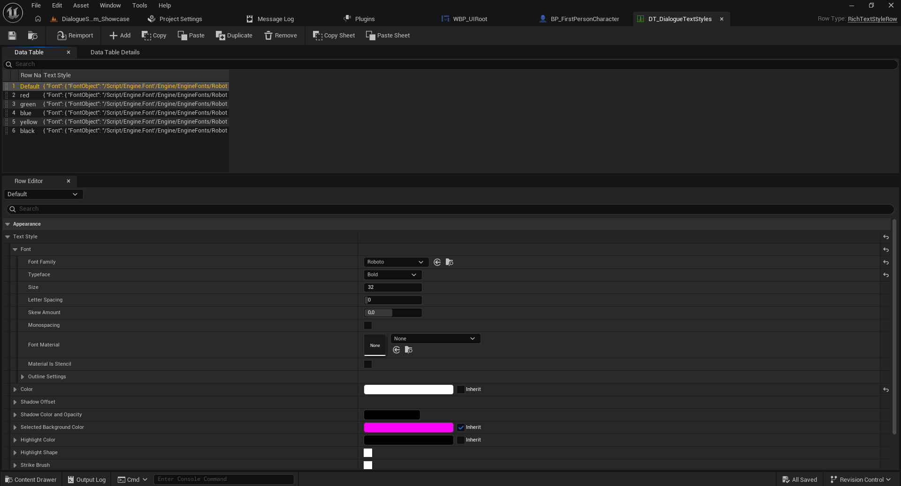
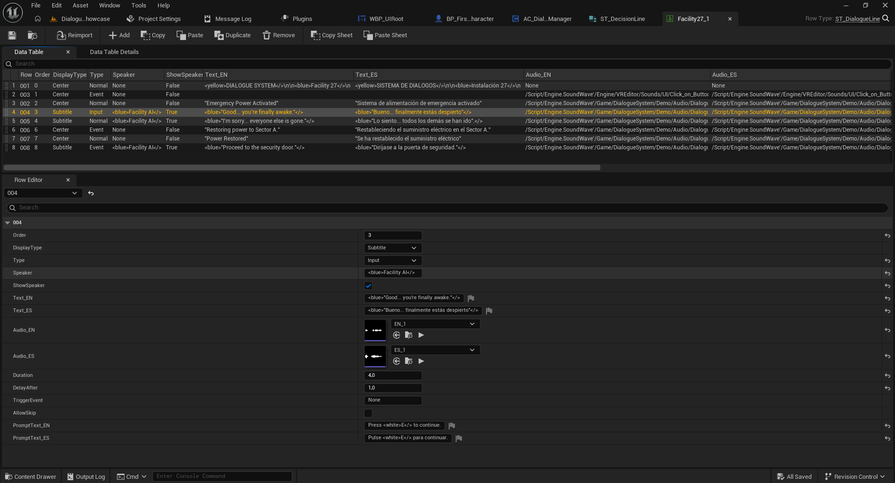
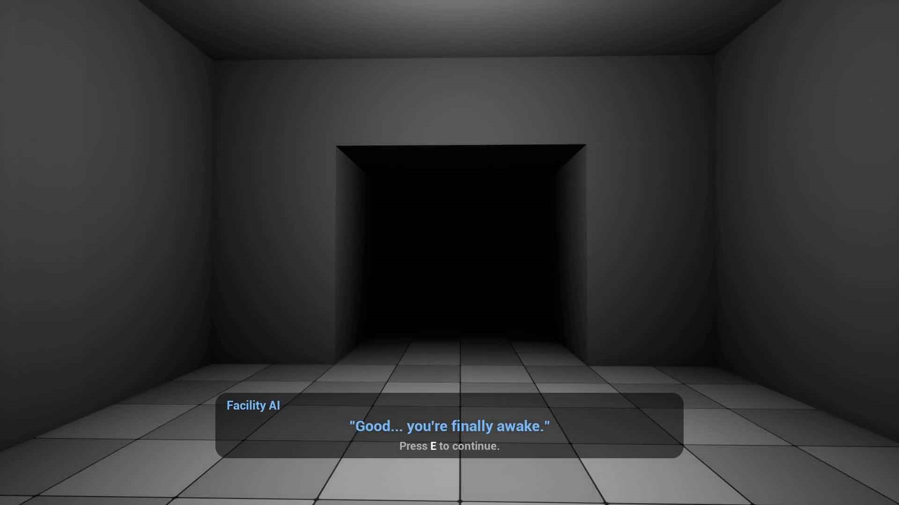

# 05 — Rich Text: Colored Words and Phrases (Full)

[← Documentation index](../README.md)

Full can highlight individual words or phrases inside a dialogue line using **Rich Text** styles.

## 1. Style Data Table

The demo uses **`DT_DialogueTextStyles`** with rows such as `Default`, `red`, `green`, `blue`, `yellow`, and `black`. Its row structure is `RichTextStyleRow`, exposing font, size, color, outline, and other text-style settings.

1. Open `DT_DialogueTextStyles`.
2. Select the style you want to change.
3. Edit **Text Style > Font / Color** in the Row Editor.
4. Save the table.

## 2. Apply styles in a conversation

1. Open a conversation Data Table based on `ST_DialogueLine`.
2. Edit `Text_EN` or `Text_ES` on the intended row.
3. Add Rich Text markup using the **exact style row name** from the style table.
4. Save and play the conversation to check the result.

**Important:** Before copying literal markup from an example, compare the syntax with the working lines supplied in your Full package. The style row name must correspond to the markup used.

## 3. Check the widget

The widget that displays the dialogue must use a **Rich Text Block** with the appropriate table set under **Text Style Set**. A screenshot showing this property is still pending.

## 4. Result and recommendations

Highlight only meaningful terms, keep sufficient contrast with the background, and test both language variants. Color can help identify warnings, locations, objectives, and important objects.

Next: [Audio and controls](06-audio-and-controls.md).
