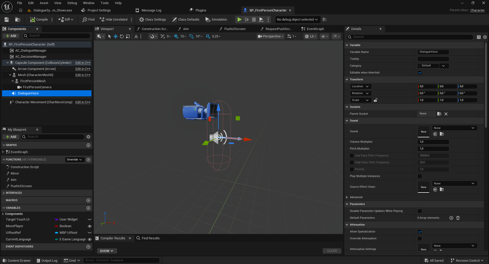
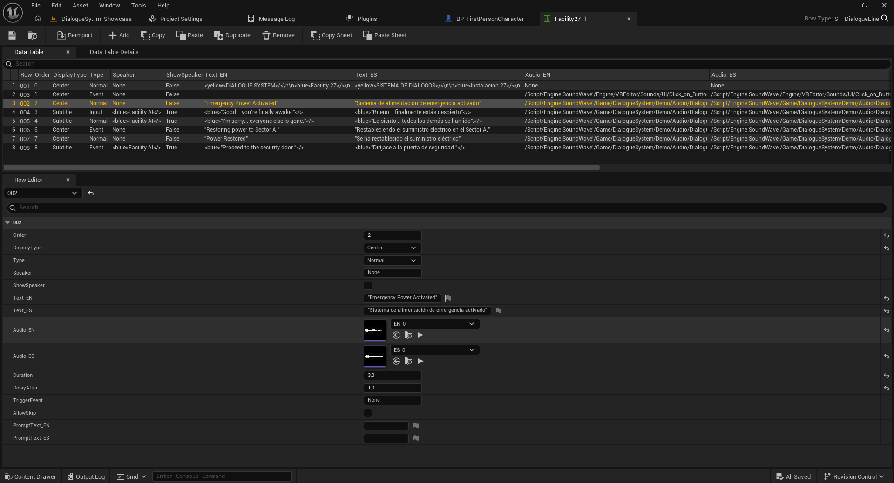
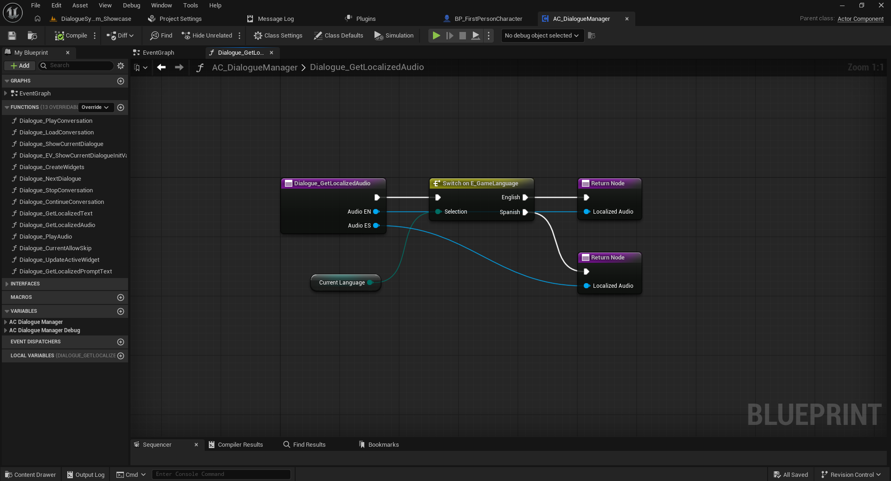
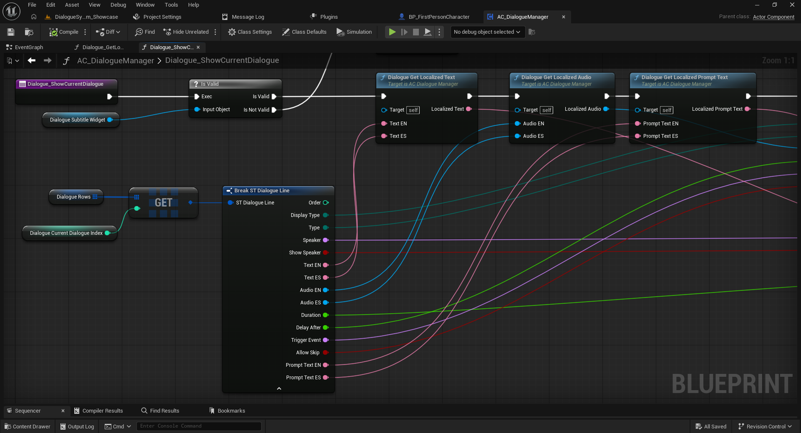
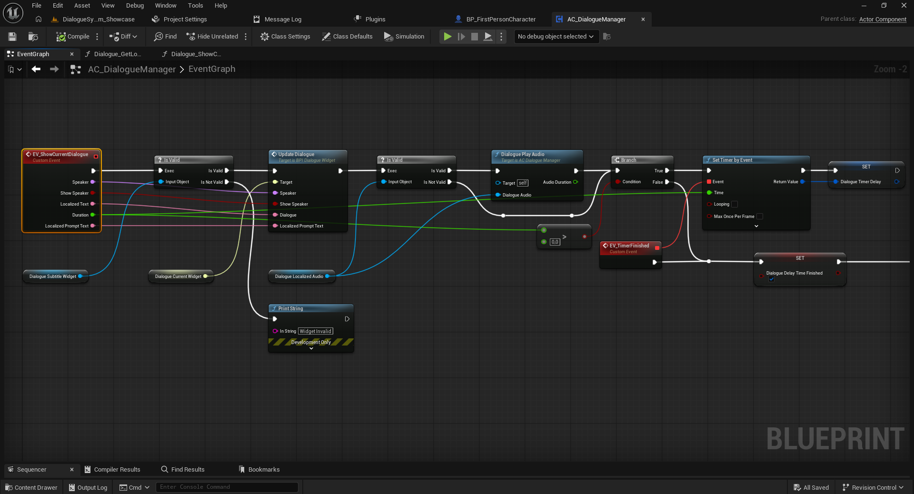
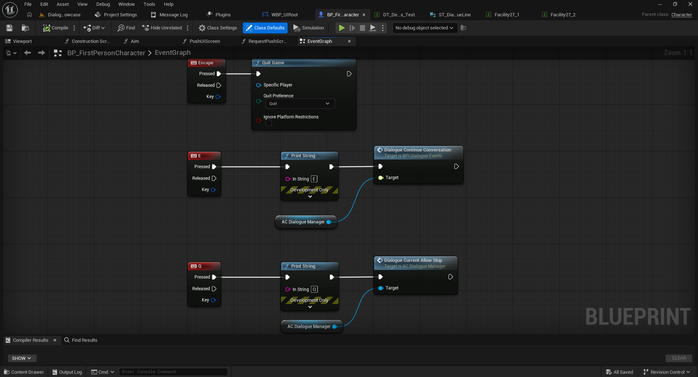

# 06 — Audio, Synchronization, Timing, and Controls

[← Documentation index](../README.md)

## 1. Prepare the voice playback component

The demo adds an **Audio Component** named `DialogueVoice` to `BP_FirstPersonCharacter`. Its default Sound can remain `None` because each dialogue row supplies its localized voice asset.

## 2. Configure dialogue rows

A Data Table based on `ST_DialogueLine` includes:

- `Audio_EN` / `Audio_ES`: per-language audio references (`Sound Base`).
- `Duration`: configured duration of the dialogue line.
- `DelayAfter`: additional pause after the line.
- `AllowSkip`: controls whether a line can be skipped in Full.
- `PromptText_EN` / `PromptText_ES`: localized context prompts.

## 3. Choose audio based on the language

In **`AC_DialogueManager`**, `Dialogue_GetLocalizedAudio` uses `Switch on E_GameLanguage` to return `Audio EN` for English and `Audio ES` for Spanish.

When displaying a line, the manager reads the localized text, audio, and prompt from `ST_DialogueLine`, updates the dialogue widget, and calls `Dialogue Play Audio`. Its `Audio Duration` output participates in the timing logic alongside the configured line duration.

**Technical note:** To document the exact priority between `Audio Duration` and `Duration` with and without an audio asset, inspect the complete `Dialogue_PlayAudio` function and the `Set Timer by Event` connections. The available screenshot only shows part of the flow.

## 4. Player controls

In the demo:

- `E` calls `Dialogue Continue Conversation` through `BPI_DialogueEvents`.
- `Q` calls `Dialogue Current Allow Skip` on `AC_DialogueManager`.

These example keys can be replaced by Enhanced Input mappings or your game's own input scheme.

Next: [Localization and layouts](07-localization-and-layouts.md).
