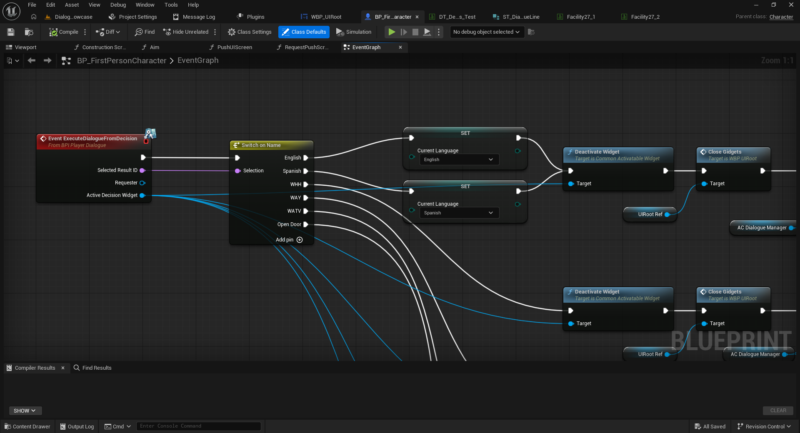
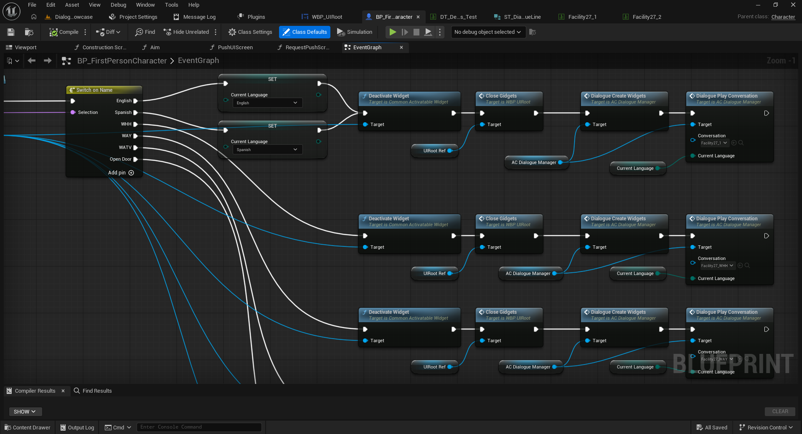
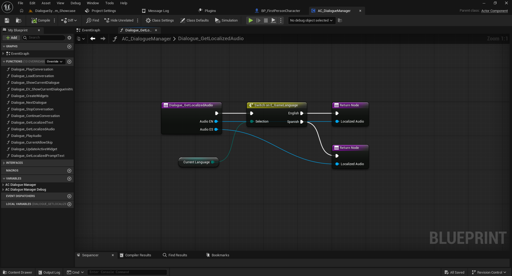
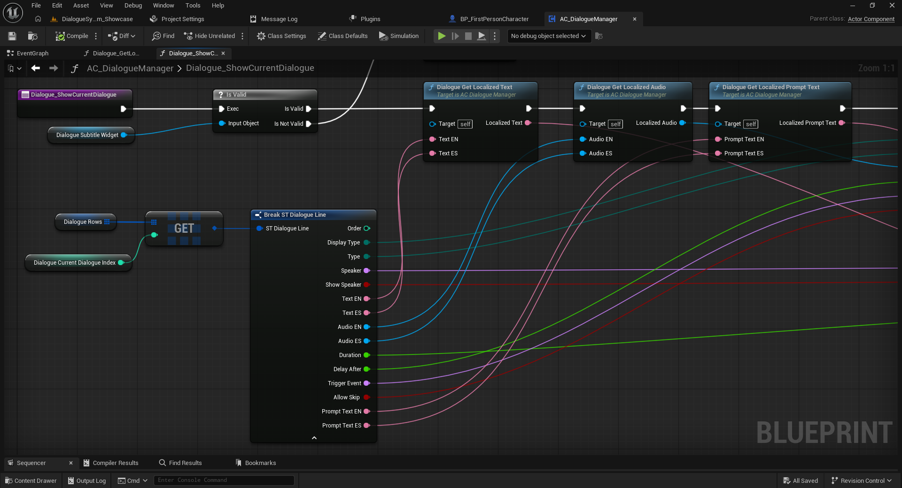

# 07 — Localization and Dialogue Layouts

[← Documentation index](../README.md)

## 1. Spanish and English localization

Each line can contain the pairs `Text_ES` / `Text_EN`, `Audio_ES` / `Audio_EN`, and `PromptText_ES` / `PromptText_EN`.

In the Full demo, the player stores `Current Language` and passes it to both `Decision Play Choices` and `Dialogue Play Conversation`. `ExecuteDialogueFromDecision` handles `English` and `Spanish` result IDs and updates this variable before rebuilding the dialogue widgets. Do not follow legacy GameInstance instructions.

## 2. Subtitle layout

`DisplayType = Subtitle` shows the line at the bottom of the screen using the configured subtitle widget.

## 3. Centered layout

`DisplayType = Center` presents the line through a centered widget, useful for scene messages and notices.

The older documentation references `WBP_Subtitles` and `WBP_CenterDialogue`. Verify the asset names in your current Full package.

## 4. Speaker names and prompts

- `Speaker`: identifies the speaker.
- `ShowSpeaker`: shows or hides the speaker name.
- `PromptText_ES` / `PromptText_EN`: localized supporting message.

## 5. Additional languages or presentation styles

Adding languages or dialogue widgets requires adjusting the data and selection logic in the component. Older documentation mentions `BPI_DialogueWidget`, `EDialogueDisplay`, and widget update functions; **verify current asset names and connections** before extending the framework.

Next: [Upgrading](08-upgrading.md).
